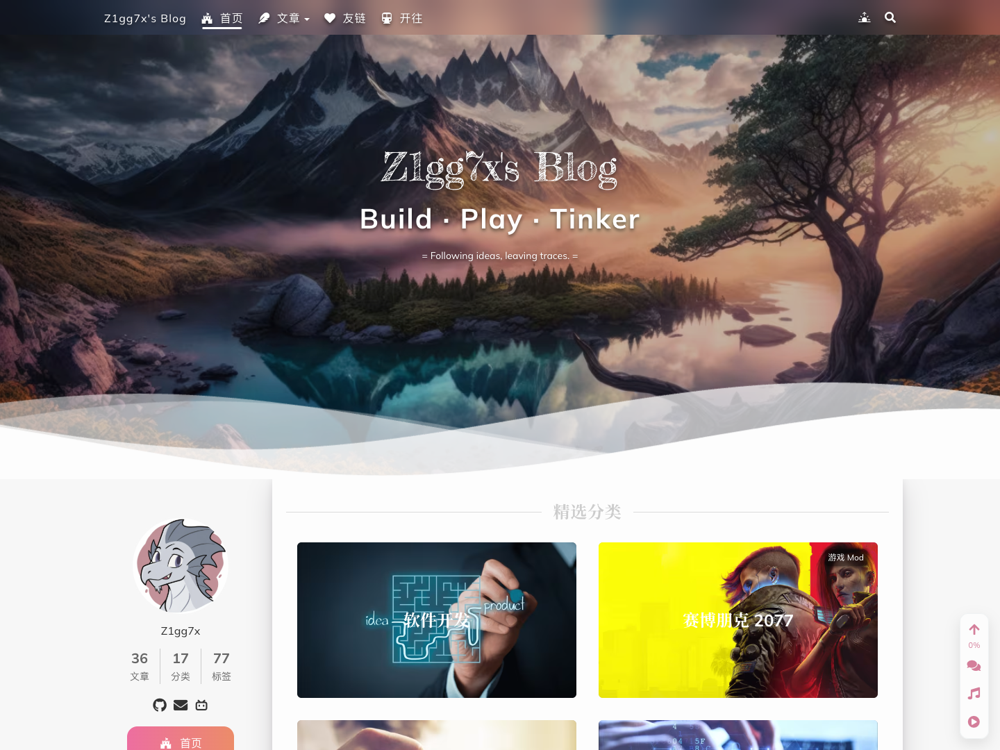

<div align="center">

# Z1gg7x's Blog

**Build · Play · Tinker**

Following ideas, leaving traces.

基于 Hexo 和 ShokaX 的个人博客，包含文章源码与主题修改。

[](https://hexo.io/)
[](https://github.com/theme-shoka-x/hexo-theme-shokaX)
[](https://sycamore.top/)

[访问博客](https://sycamore.top/) · [快速开始](#快速开始) · [维护指南](docs/maintenance.md) · [写作规范](AGENTS.md)



</div>

## 关于项目

博客地址：**[sycamore.top](https://sycamore.top/)**。

在 ShokaX 的基础上，调整了分类、归档、图片展示和评论跳转，也单独处理了关于页和友链页的布局。文章使用 Markdown 编写，页面由 Hexo 生成，部署到 GitHub Pages。

主题修改尽量放在项目自己的脚本、样式和模板中。主题源码修改由 `lib/theme-patches.js` 在安装时应用。当前适配 ShokaX 0.4.17；重装依赖可恢复补丁，升级主题后仍需检查兼容性并验证页面与交互。

## 主要功能

- **分类与归档**：在一个页面浏览分类，展开后每页显示 5 篇文章；子分类链接会自动展开并定位，分类按最新文章的发布时间排序。
- **图片**：构建时预留图片尺寸，正文显示宽度可逐图调整。Cloudinary 图片使用适合展示尺寸的派生图，点击放大查看原图。
- **评论**：使用 Waline，接近评论区时加载；点击最新评论可跳转到文章内的对应评论，评论预览会过滤不安全的 HTML。
- **阅读**：深浅色切换、手机布局、文章目录和本地全文搜索；提供字数、代码行数、阅读时长，以及按更新年份判断的过期提醒。
- **独立页面**：关于页和友链页使用各自的布局，友链包含头像占位、本站信息和申请说明。

## 快速开始

已验证的本地环境为 **macOS、Node.js 24 和 pnpm 12.11.2**，依赖版本以 `pnpm-lock.yaml` 为准。

主题补丁使用 Node.js 执行，不依赖 macOS 的 `sed`。其他系统尚未完成整站运行验证，参见[本地运行说明](docs/maintenance.md#本地运行)。

```sh
git clone --branch source https://github.com/zixu0779/zixu0779.github.io.git
cd zixu0779.github.io
pnpm install --frozen-lockfile

# 本地生成
NODE_USE_ENV_PROXY=1 node_modules/.bin/hexo generate

# 启动预览
npm run server
```

首次安装使用 pnpm 12 时，需要明确授权依赖的构建脚本；Node.js 24 下的 `deasync` 还需要 `node-gyp`、Python 和本机 C/C++ 构建工具。遇到 `ERR_PNPM_IGNORED_BUILDS` 或 `node-gyp: command not found` 时，按[首次安装与原生依赖](docs/maintenance.md#首次安装与原生依赖)处理，再继续生成页面。不要将依赖下载完成视为安装成功。

启动后访问 <http://localhost:4000/>。依赖安装时直接运行 `node lib/theme-patches.js`，用于应用主题修改。生成页面时，尚未缓存尺寸的图片需要联网读取。

> 用于自己的站点前，请修改 `_config.yml` 和 `_config.shokaX.yml` 中的域名、评论服务及部署地址。

## 项目结构

```text
.
├── _config.yml                  # Hexo 与部署配置
├── _config.shokaX.yml            # 主题与站点功能配置
├── source/
│   ├── _posts/                  # 文章 Markdown
│   ├── _data/                   # 站点数据、样式、图片显示尺寸
│   ├── _layouts/                # 页面与组件模板覆盖
│   ├── _waline/                 # 评论辅助逻辑
│   └── js/                      # 分类、侧栏、图片等前端交互
├── scripts/                     # Hexo 扩展与生成阶段处理
├── lib/                         # 主题补丁与共用逻辑
├── tests/                       # 回归检查
├── tools/                       # 图片等维护工具
├── docs/                        # 维护文档与项目预览
└── image-dimensions.json         # 原图宽高缓存
```

`public/` 是构建产物，不直接编辑。源码维护在 `source` 分支，静态站点发布到 `main`，由 GitHub Pages 托管。

## 维护文档

| 内容 | 文档 |
| --- | --- |
| 撰写文章、检查每张配图 | [博客写作规范](AGENTS.md) |
| 修改标题、分类、路径或过期提醒 | [写作与文章整理](docs/maintenance.md#写作与文章整理) |
| 调整图片、封面与头像 | [图片、封面和头像](docs/maintenance.md#图片封面和头像) |
| 修改分类分页、侧栏或页面样式 | [界面与交互约定](docs/maintenance.md#界面与交互约定) |
| 排查评论加载、迁移历史评论 | [评论系统与性能](docs/maintenance.md#评论系统与性能) |
| 运行检查、提交与发布 | [验证与发布](docs/maintenance.md#验证与发布) |

主题升级、文章整理和图片调整的具体要求见维护指南。仅修改标题、分类或图片配置时，不更新文章的发布时间和修改时间。

## 验证与发布

```sh
# 生成后，按改动范围运行相关检查
node tests/category-navigation.test.js
node tests/category-pagination.test.js
node tests/comment-anchors.test.js
node tests/vendor-security.test.js
node tests/image-dimensions.test.js
```

这些检查需在生成页面后运行。提交前还需检查桌面和手机窄屏下的实际效果；图片变更另查占位、比例和放大功能。完整流程见[验证与发布](docs/maintenance.md#验证与发布)。

`npm run build` 只生成页面；`npm run deploy` 会发布到配置的远程仓库。协作修改默认保留在本地，提交、推送和发布须经作者确认。私有备份和凭据不纳入版本控制，也不随站点发布。

外部脚本保留 CDN 地址，加载前校验 SHA-384；失败或超时后使用固定的本地副本。Busuanzi 动态统计沿用 JSONP，不属于固定哈希校验范围。维护方式与限制见[外部脚本与安全检查](docs/maintenance.md#外部脚本与安全检查)。

## 致谢

本站基于 [Hexo](https://hexo.io/) 和 [ShokaX](https://github.com/theme-shoka-x/hexo-theme-shokaX)，评论由 [Waline](https://waline.js.org/) 提供，图片使用 [Cloudinary](https://cloudinary.com/)。感谢这些项目的作者与维护者。

## 使用许可

文章以各篇标注的授权为准，主题、依赖和图片素材遵循各自的许可。本仓库尚未提供统一的开源许可证。
