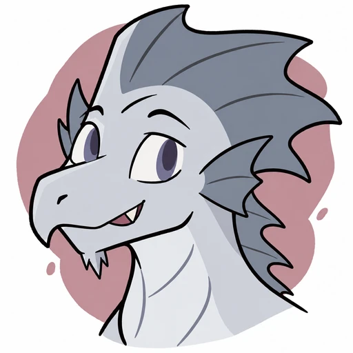

# Friends



- site: 咖啡豆子coffee的小站
  url: https://blog.kfdzcoffee.cn
  desc: Where every miracle begins
  image: https://image.kfdzcoffee.cn/i/1/avatar.png
  color: "#af9bc0"
- site: Jlan
  url: https://jlan.darkflow.top/
  desc: My web bro@BXS
  image: https://res.cloudinary.com/sycamore/image/upload/v1792085081/Typora/2023/04/94d6febc1d62e18839744a838e99ce60.png
  color: "#EC896E"
- site: Yae Publishing House
  url: https://joker233.top
  desc: Aspiring to master the art of pwn.
  image: images/friends/ret2-joker233.webp
  color: "#FF1493"



<!-- friend-application -->

<section class="friend-box">

<h2 id="friend-detail-1">Z1gg7x's Blog</h2>
Following ideas, leaving traces.

Site name<strong>Z1gg7x&#x27;s Blog</strong><button type="button" data-friend-copy="Z1gg7x&#x27;s Blog" aria-label="Copy site name"><svg viewBox="0 0 24 24" aria-hidden="true"><rect x="8" y="8" width="12" height="13" rx="2"/><path d="M16 8V5a2 2 0 0 0-2-2H5a2 2 0 0 0-2 2v9a2 2 0 0 0 2 2h3"/></svg></button>

Description<strong>Following ideas, leaving traces.</strong><button type="button" data-friend-copy="Following ideas, leaving traces." aria-label="Copy description"><svg viewBox="0 0 24 24" aria-hidden="true"><rect x="8" y="8" width="12" height="13" rx="2"/><path d="M16 8V5a2 2 0 0 0-2-2H5a2 2 0 0 0-2 2v9a2 2 0 0 0 2 2h3"/></svg></button>

Site URL<strong>https://www.sycamore.top</strong><button type="button" data-friend-copy="https://www.sycamore.top" aria-label="Copy site URL"><svg viewBox="0 0 24 24" aria-hidden="true"><rect x="8" y="8" width="12" height="13" rx="2"/><path d="M16 8V5a2 2 0 0 0-2-2H5a2 2 0 0 0-2 2v9a2 2 0 0 0 2 2h3"/></svg></button>

Avatar URL<strong>https://sycamore.top/assets/Z1gg7x_SilverDragon_Pink_512.webp</strong><button type="button" data-friend-copy="https://sycamore.top/assets/Z1gg7x_SilverDragon_Pink_512.webp" aria-label="Copy avatar URL"><svg viewBox="0 0 24 24" aria-hidden="true"><rect x="8" y="8" width="12" height="13" rx="2"/><path d="M16 8V5a2 2 0 0 0-2-2H5a2 2 0 0 0-2 2v9a2 2 0 0 0 2 2h3"/></svg></button>

Site colour<strong>#d47e9a</strong><button type="button" data-friend-copy="#d47e9a" aria-label="Copy site colour"><svg viewBox="0 0 24 24" aria-hidden="true"><rect x="8" y="8" width="12" height="13" rx="2"/><path d="M16 8V5a2 2 0 0 0-2-2H5a2 2 0 0 0-2 2v9a2 2 0 0 0 2 2h3"/></svg></button>
</section>
<section class="friend-box"><h2 id="friend-detail-2"><svg viewBox="0 0 24 24" aria-hidden="true"><rect x="8" y="2" width="8" height="4" rx="2"/><path d="M8 4H6a2 2 0 0 0-2 2v14a2 2 0 0 0 2 2h12a2 2 0 0 0 2-2V6a2 2 0 0 0-2-2h-2M8 13l3 3 5-6"/></svg>Request a link exchange</h2><ol class="friend-steps"><li data-step="1"><h3 id="friend-detail-3">Add my blog to your site</h3>
Add my blog to your site first. You can copy each field from the site details.
</li><li data-step="2"><h3 id="friend-detail-4">Send me your site details</h3>
Leave a comment below or email <a href="mailto:zixu0779@gmail.com"><code>zixu0779@gmail.com</code></a>.

<pre>Site name: Your site name
Description: A short description
Site URL: https://example.com
Avatar URL: https://example.com/avatar.png
Site colour: #yourcolour</pre><button type="button" data-friend-copy="Site name: Your site name
Description: A short description
Site URL: https://example.com
Avatar URL: https://example.com/avatar.png
Site colour: #yourcolour" aria-label="Copy the request template"><svg viewBox="0 0 24 24" aria-hidden="true"><rect x="8" y="8" width="12" height="13" rx="2"/><path d="M16 8V5a2 2 0 0 0-2-2H5a2 2 0 0 0-2 2v9a2 2 0 0 0 2 2h3"/></svg></button>
</li><li data-step="3"><h3 id="friend-detail-5">Wait for a reply</h3>
Once I’ve checked the details, I’ll add your link as soon as I can.

If you leave out the colour, I’ll pick one to match your site.
</li></ol></section>


